<p align="center">
  
</p>

### `$ cat about.md`
```text
{{NAME}} | Lead DevOps / SRE Engineer | {{YEARS}} yrs
I own reliability and delivery for {{SCALE}}.
I optimize for: low toil, fast recovery, boring deploys.
```

### `$ git log --oneline --impact`
```text
a1f3c9e Cut {{SYSTEM_1}} {{METRIC_1}} by {{RESULT_1}}
b72d0a4 Reduced MTTR from {{BASELINE}} to {{NEW}} via {{HOW}}
c9e81b2 Moved {{SYSTEM_2}} to Terraform: {{RESULT_2}}
d04a7f6 Introduced SLOs/error budgets across {{N}} services
```

### `$ kubectl get skills -o wide`
```text
AREA            TOOLS                          LEVEL
cloud           AWS, GCP                       production
orchestration   Kubernetes                     production
iac             Terraform                      production
sre             SLOs, error budgets, on-call   lead
reliability     incident command, postmortems  lead
delivery        CI/CD, release automation      lead
observability   {{YOUR_TOOLS}}                 production
```

### `$ cat runbook.md`
```text
1. If a human does it twice, automate it.
2. No SLO, no alert. No alert, no pager.
3. Postmortems are blameless and have owners.
4. Every change must be reversible.
```

### `$ ls ~/projects`
```text
[Aetheria](https://github.com/dhileepdev/Aetheria)
[compliance-scanner](https://github.com/dhileepdev/compliance-security-scanner-portfolio)
[dr-dashboard](https://github.com/dhileepdev/dr-incident-dashboard)
[devops-ecosystem](https://github.com/dhileepdev/devops-plugin-ecosystem)
```

### `$ ./contact.sh`
[LinkedIn]({{@dhileep-kumar-99955874}}) | [Email](mailto:{{hello@dhileep.info}}) | [Site]({{https://dhileep.info}})